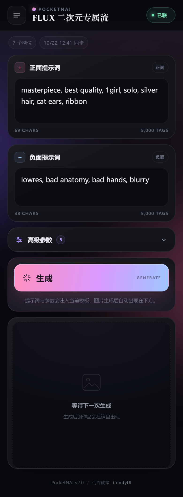

# ComfyUI-suski-PocketNAI

基于「槽位注入」的 ComfyUI 移动端极简控制器。PC 端把工作流里的任意输入控件绑定成槽位，移动端只负责填写这些槽位，然后调用 ComfyUI 原生队列执行。



## 功能

- PC 画布节点右键菜单：`suski 移动端槽位`
- `SaveImage` / `PreviewImage` 右键：`设为 suski 主输出`
- 槽位元数据写入工作流 `extra.suski_config`，同时同步到后端内存
- 子图实例上的槽位会展开为内部节点的 `targets`，注入时直接写真实 API Prompt 节点
- 后端深拷贝 API Prompt，覆盖槽位值后交给 `execution.validate_prompt` 和原生队列
- 生成中可一键停止：中断正在执行的任务，并把它从等待队列里移除
- 工作流模板自动落盘到 `saved_workflows/`，ComfyUI 重启后恢复上次活动的工作流
- 移动端可列出并切换已保存的工作流，不再依赖 PC 画布在线
- 移动端编辑通过 `/suski/api/apply_slots` 写回 PC 画布；删除 LoRA/磁贴会同步到工作流
- 删除 LoRA 时同时重建 PC 节点上的 `<lora:...>` 文本，旧 LoRA 不会在下次合并时复活
- `seed == -1` 在入队前随机化
- 移动端为 Vue 3 + Tailwind CSS + Tribute.js PWA，图标全部为手绘线性 SVG
- Danbooru 词库自动发现，IndexedDB 缓存
- WebSocket 进度、执行错误、输出图片同步
- 图片使用原生 ``，移动端可长按保存
- 移动端内置原生 LoRA 选择器：读取本地封面、底模、触发词与推荐权重，无需 PC 端 `lora_loader.js`
- Prompt-Vault 为可选依赖，缺失时相关入口自动隐藏

## 安装

把整个目录放入 `ComfyUI/custom_nodes/`，重启 ComfyUI。`dist/` 已包含构建后的移动端，无需在 ComfyUI 环境里安装 Node 依赖。

局域网访问需要让 ComfyUI 监听外部网卡，例如：

```bash
python main.py --listen 0.0.0.0
```

然后在手机浏览器打开：

```text
http://<PC 的局域网 IP>:8188/suski/
```

## 使用

1. 在 PC 端打开一个工作流。
2. 右键需要交给手机的节点，进入 `suski 移动端槽位`，勾选输入控件。
3. 右键 `SaveImage` 或 `PreviewImage`，选择 `设为 suski 主输出`。
4. 保存工作流或直接点一次队列，模板会自动同步并落盘。
5. 手机打开 `/suski/`，填写提示词和参数，点击「生成」；生成中按钮会变成「停止生成」。

槽位绑定会随工作流保存。再次打开工作流时，PC 扩展会重新读取 `extra.suski_config` 并同步给后端。

模板落盘后不再依赖 PC 画布：关闭所有 PC 浏览器标签、重启 ComfyUI，手机端仍会拿到上次的模板，可以直接出图；
点顶部标题或侧边菜单里的「切换工作流」可以列出 `saved_workflows/` 里的所有工作流并一键切换。

## 工作流持久化

- 每次 `POST /suski/api/sync_template` 与 `POST /suski/api/apply_slots` 成功后，后端都会把当前
  `api_prompt` + `suski_config` 写到 `saved_workflows/<id>.json`，并把 id 写进 `saved_workflows/_active.json`。
- 插件加载（ComfyUI 启动）时会自动恢复活动工作流；文件损坏时按更新时间回退到下一条可用工作流。
- id 由工作流标题规范化而来（非法字符替换、小写、截断 80 字符），同一标题的多次保存会覆盖同一个文件。
- 切换工作流只影响服务端活动模板与移动端；PC 画布保持当前工作流，PC 再次保存/排队时会把它的模板重新推上来，
  这属于「PC 在线则协同」的预期行为。

## 槽位类型

| `type` | 来源 | 移动端控件 |
| --- | --- | --- |
| `prompt` / `negative` / `text` | 任意文本控件 | 多行提示词输入 |
| `seed` / `slider` / `number` / `toggle` / `combo` | 任意参数控件 | 对应参数控件 |
| `lm_loras` | `Lora Loader (LoraManager)` 的 `loras` 控件 | 已挂载 LoRA 托盘 |
| `pv_tiles` | `PromptVaultSelector` 的 `selected_tiles_data` 控件 | 预设磁贴列表 |

`lm_loras` 与 `pv_tiles` 都是对象数组，提交时会转换为节点真正读取的结构：

- `LoraLoaderLM` 在执行阶段丢弃 `text` 控件，只认 `loras` 数组，因此槽位值会整体覆盖
  `loras`，并补上 ComfyUI 序列化数组控件所需的 `{"__value__": [...]}` 包装。
  注入时还会顺手把同一节点上的 `text` 重建成 `<lora:name:strength[:clip]>`，让服务端模板的两份
  真值保持一致；只改写本来就存在的字符串 `text`，不会新增输入项。
- `selected_tiles_data` 是 JSON 字符串，后端负责序列化，权重与启用状态原样写入磁贴。
- 绑定在子图实例上的槽位会记录 `targets`。例如 `1526/unet_name` 会写成
  `1526:1732/model_name`，执行时只改内部真实节点；子图被删除或输入被连线时，
  PC 端会清理槽位，后端也会跳过失效目标而不是报“节点不存在”。

## 对接 Lora-Manager 与 Prompt-Vault

Prompt-Vault 是可选项，移动端通过 `GET /suski/api/integrations` 探测路由是否存在，探测不到就
隐藏「预设库」入口，原生槽位不受影响。LoRA 选配只依赖本机 `models/loras` 目录，不再需要额外的
iframe 入口。

### Lora-Manager

1. 在 PC 端右键 `Lora Loader (LoraManager)`，把 `LoRA 挂载列表` 绑定为槽位。
2. 手机端 LoRA 面板右上角点「添加 LoRA」，直接从本机 `models/loras` 里挑；抽屉内可搜索模型名、
   目录、底模与触发词，卡片显示本地封面、底模徽章与推荐权重。整个流程只读本地文件，**PC 端关掉也能用**。
3. 点触发词标签会把词条插入正面提示词（有光标时按光标位置插入）。
4. 托盘里可直接静音、删除、按 `0.05` 步进调权，修改会立即写回 `loras` 数组和 PC 画布。
   删除时 PC 钩子会同步重建节点上的 `text` 控件，旧 LoRA 的标签被彻底清除，之后再加新 LoRA 也不会复活。

LoRA 伴随文件嗅探规则（纯本地，无外网请求）：

| 类型 | 查找顺序 |
| --- | --- |
| 封面 | `<stem>.preview.png` → `.preview.jpg` → `.preview.jpeg` → `.preview.webp` → `.png` → `.jpg` → `.jpeg` → `.webp` |
| 元数据 | `<stem>.metadata.json` → `<stem>.civitai.info` → `<stem>.json` |
| 触发词 | `trainedWords` / `trigger_words` / `activation_text`（顶层或 `civitai`、`modelVersion` 内） |
| 推荐权重 | `preferredWeight` / `preferred_weight` / `recommended_weight` / `weight` / `usage_tips.strength` |
| 底模 | `base_model` / `baseModel`（顶层或 `civitai`、`modelVersion`、`model` 内） |

`/suski/api/loras` 返回的 `name` 是相对 `models/loras` 的路径（去掉 `.safetensors` 等扩展名），
与 Lora-Manager 在 `loras` 数组里保存的写法一致；`base_name` 只保留文件名，`folder` 用于展示目录。
元数据缺失时接口会优雅降级（`has_meta=false`、权重 1.0），不影响选用。

### Prompt-Vault

1. 提示词输入框上方的 `预设库` 打开底部抽屉，按分类/收藏筛选、搜索、长按查看详情。
2. 点词条按光标位置插入文本（不唤起键盘，顶部会给出插入成功提示），非 1.0 权重会格式化为 `(prompt:weight)`；点组合按顺序展开。
3. `PromptVaultSelector` 的 `selected_tiles_data` 绑定为槽位后，同一抽屉切换为磁贴模式，
   可增删、拖动排序、静音与调权；修改会同步回真实磁贴数据。
4. PC 端保存词库会广播 `prompt_vault:library_updated`，手机端静默刷新 IndexedDB 缓存与列表。

## 词库发现顺序

后端按以下顺序查找第一个有效文件：

1. `custom_nodes/ComfyUI-Custom-Scripts/user/autocomplete/danbooru.csv`
2. `custom_nodes/comfyui-custom-scripts/user/autocomplete/danbooru.csv`
3. `custom_nodes/ComfyUI-Custom-Scripts/web/js/assets/danbooru.csv`
4. `custom_nodes/comfyui-custom-scripts/web/js/assets/danbooru.csv`
5. `custom_nodes/ComfyUI_tagcomplete/tags/danbooru.csv`
6. `custom_nodes/ComfyUI-Autocomplete-Aaalice/data/danbooru_tags.csv`
7. 内置 `backend/assets/danbooru_min.csv`（Top 5000）

## API

| 路径 | 方法 | 说明 |
| --- | --- | --- |
| `/suski` | GET | 移动端入口 |
| `/suski/api/config` | GET | 当前模板与 `suski_config` |
| `/suski/api/integrations` | GET | 探测 Prompt-Vault 是否可用 |
| `/suski/api/sync_template` | POST | 接收 `api_prompt` 与 `suski_config`，成功后落盘 |
| `/suski/api/workflows` | GET | 列出已保存的工作流与当前活动项 |
| `/suski/api/workflows/switch` | POST | 切换活动工作流（`{"id": "<id>"}`） |
| `/suski/api/loras` | GET | 本地 LoRA 列表 + 伴随元数据（`?refresh=1` 跳过缓存） |
| `/suski/api/lora_preview` | GET | 输出 LoRA 本地封面（`?name=<相对路径>`） |
| `/suski/api/tags.csv` | GET | 输出当前词库文件 |
| `/suski/api/apply_slots` | POST | 把移动端编辑写回模板、落盘并广播给 PC 画布 |
| `/suski/api/execute` | POST | 注入槽位、校验并入队 |
| `/suski/api/cancel` | POST | 停止生成（`{"prompt_id": "..."}`，中断执行并移出等待队列） |

`POST /suski/api/execute` 的负载：

```json
{
  "client_id": "uuid",
  "slots_data": {
    "6": { "text": "1girl, silver hair" },
    "3": { "seed": -1, "steps": 28 },
    "12": {
      "loras": [
        { "name": "anime_eyes_v1", "strength": 0.85, "clipStrength": 0.85, "active": true }
      ]
    },
    "20": {
      "selected_tiles_data": [
        { "instance_id": "t1", "title": "逆光", "prompt": "backlight", "weight": 1.2, "enabled": true }
      ]
    }
  }
}
```

`/suski/api/apply_slots` 使用同样的 `slots_data` 结构，只更新其中出现的槽位。移动端编辑会以 450ms debounce 写回；后端更新模板、落盘后广播 `suski:apply_slots`，PC 端把它写进真实控件并重新同步。PC 端不在线时后端模板仍会更新并落盘，下次生成使用该模板；PC 画布与工作流文件要等 PC 打开并同步后才会变化。

## 移动端开发

```bash
cd mobile_web
npm install
npm run build
```

`vite.config.js` 将产物直接写入项目根目录的 `dist/`。开发预览可使用 `npm run dev`，但 `/suski/api/*` 与 `/ws` 需要由 ComfyUI 提供。

## 说明

- PWA 安装与 Service Worker 需要 HTTPS 或 `localhost`。局域网 HTTP 仍可正常使用页面，但浏览器不会提供安装能力。
- 移动端、词库与 LoRA 元数据请求只访问本机 ComfyUI，不包含外部网络请求、遥测或统计。
- 同一时间只有一个活动模板。移动端可以切换活动工作流；如果 PC 端同时开着另一个工作流并保存/排队，PC 会把自己的模板重新推上来覆盖活动项。
- `saved_workflows/` 是运行时数据，默认不纳入版本控制；删除其中某个 JSON 即可从切换列表里移除对应工作流。
